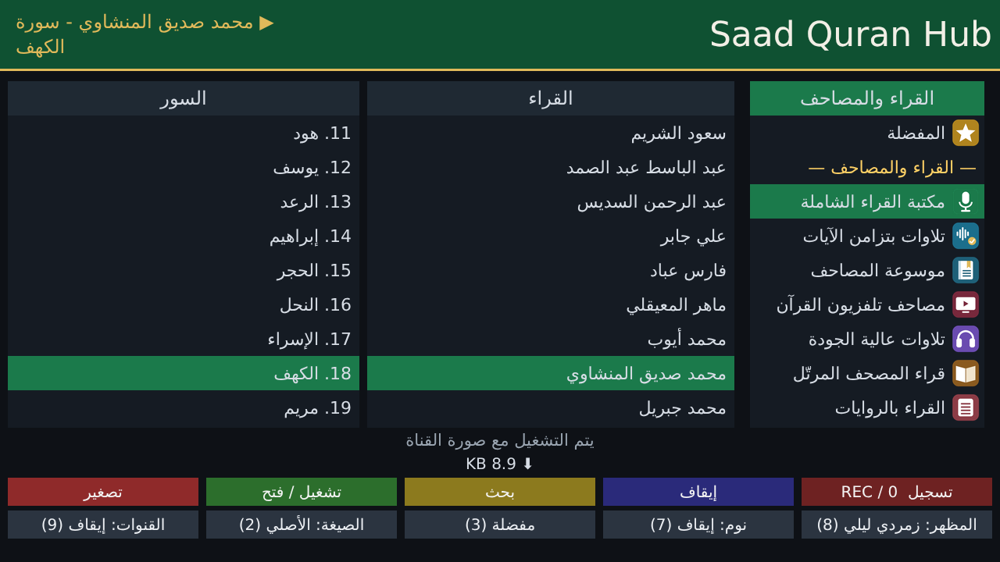
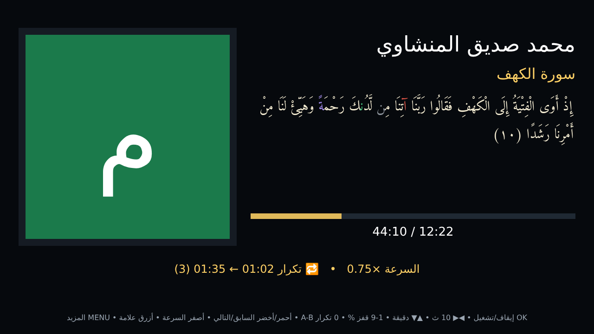
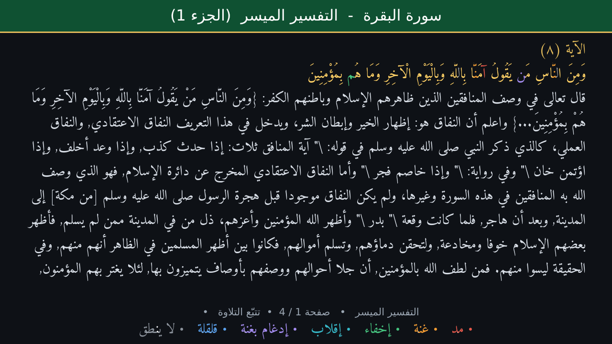
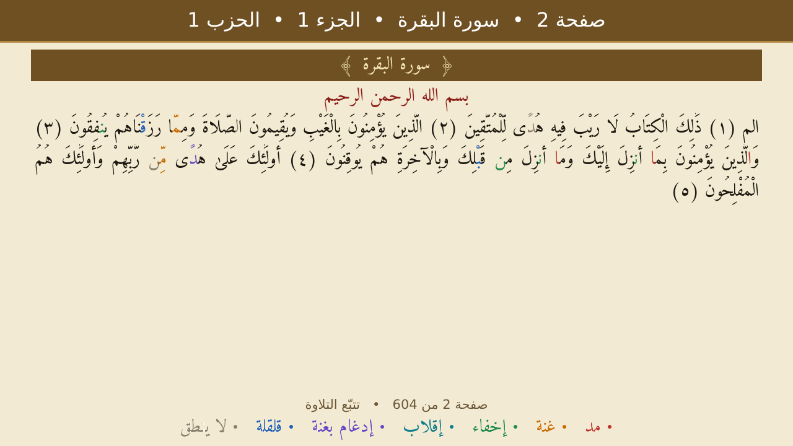
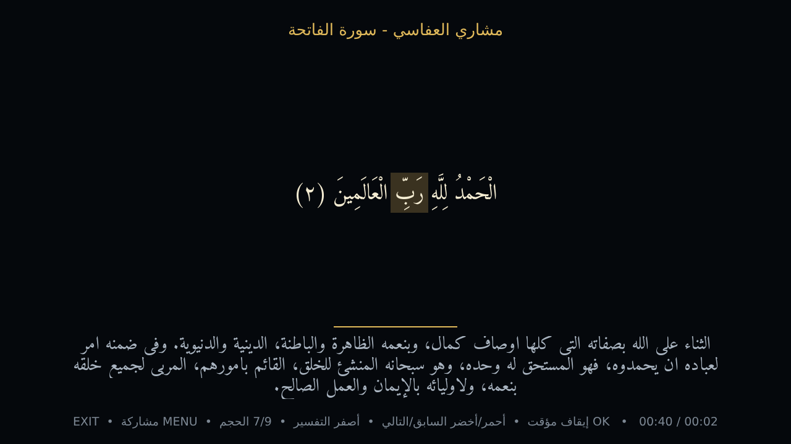
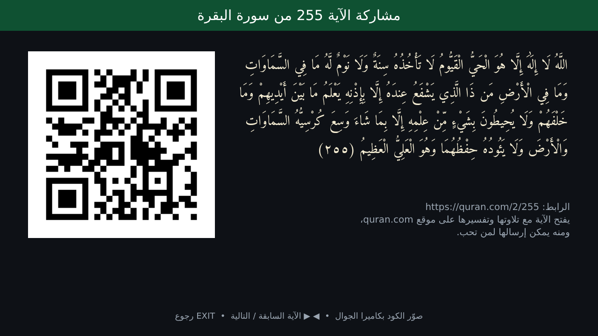

# Saad Quran Hub - القرآن الكريم لأجهزة Enigma2

إضافة مجانية لأجهزة الاستقبال بنظام Enigma2 (OpenBlackHole وغيرها، Python 3). تجمع تلاوات القرآن الكريم والإذاعات من أكثر من عشرة مواقع، وتشغّلها في الخلفية مع بقاء صورة قناة الدش أو الكيبل.

## المزايا

- **الاستماع:** آلاف القراء والروايات والإذاعات المباشرة، والبحث عن أي قارئ في كل المواقع معاً.
- **المشغّل الكبير:** سرعة التلاوة بنفس صوت الشيخ، وتكرار مقطع أو آية، والعلامات، وقائمة «التالي»، والمتابعة من حيث توقفت.
- **القراءة:** المصحف بالصفحات (604 صفحات)، والتفسير بثمانية كتب، والترجمة، وتلوين أحكام التجويد، وتظليل الآية التي يقرؤها الشيخ.
- **الحفظ:** استوديو للحفظ والمراجعة الذكية والاختبار، ووضع للأطفال، وختمة يومية.
- **ملفاتك:** تنزيل أي قارئ بالصيغة التي تريدها (MP3 / FLAC / ...)، ومكتبة لملفاتك، ومجلدات الـHDD كمصدر، وتحويل الصيغ، والنسخ إلى فلاشة.
- **التحكم من بعيد:** بوت تليجرام خاص بك، وتطبيق للجوال على شبكة البيت.
- **قائمة القنوات:** باقة من المفضلة وباقة للإذاعات.
- **الصلاة:** المواقيت، والأذان، وأذان الفجر الذي يوقظ الجهاز.

## صور من البلاجين

| | |
| --- | --- |
|  |  |
|  |  |
|  |  |

## التثبيت

من Telnet / SSH على الريسيفر:

```sh
wget -q --no-check-certificate https://raw.githubusercontent.com/Saadmelshepiny/SaadQuranHub/main/install.sh -O - | /bin/sh
```

أو يدوياً: نزّل ملف ipk من مجلد [`ipk`](ipk)، وانسخه إلى `/tmp`، ثم:

```sh
opkg install /tmp/enigma2-plugin-extensions-saadquranhub_*_all.ipk
```

ثم أعد تشغيل الواجهة، وافتح: قائمة الإضافات ← Saad Quran Hub.

## التحديث

البلاجين يفحص هذا المستودع مرة كل يوم، ويخبرك عند صدور إصدار جديد. للتثبيت: MENU ← أدوات وتشخيص ← تحديث البلاجين. الإعدادات والمفضلة تبقى كما هي.

## بوت تليجرام

1. أنشئ بوتاً خاصاً بك من [@BotFather](https://t.me/BotFather) وانسخ التوكن.
2. في البلاجين: MENU ← بوت تليجرام ← التوكن.
3. افتح البوت واضغط Start، ثم أرسل له الرمز الظاهر على شاشة التلفزيون.

البوت لا يقبل أوامر إلا من الحسابات التي ربطتها بهذا الرمز.

## البناء من المصدر

```sh
sh tools/build_ipk.sh
```

## المصادر والتراخيص

- الكود: GNU GPL v2 (ملف [LICENSE](LICENSE)).
- نص المصحف: [Tanzil](https://tanzil.net) - يُعرض كما هو دون تعديل.
- تقسيم الصفحات والأجزاء: fawazahmed0/quran-api (ملكية عامة).
- التفاسير: spa5k/tafsir_api (MIT). الترجمة: Saheeh International عبر QuranEnc.
- الخط وصور الحروف: مشتقة من خط Amiri - SIL Open Font License 1.1.
- كود QR: Project Nayuki QR-Code-generator (MIT).
- الصوت يُشغَّل من مواقعه مباشرة (mp3quran.net، quran.com، وغيرها)، والإضافة لا تستضيف أي تلاوة.
